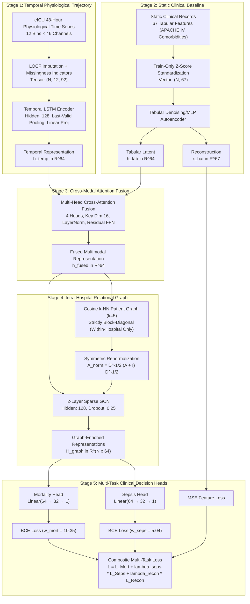

# Multimodal Relational Graph Neural Network Framework for ICU Risk Prediction

[](https://www.python.org/)
[](https://pytorch.org/)
[](https://developer.apple.com/metal/pytorch/)
[](https://eicu-crd.mit.edu/)
[](#4-hospital-level-partitioning--leakage-prevention)

An enterprise-grade, end-to-end deep learning framework for intensive care unit (ICU) clinical decision support, built upon the **eICU Collaborative Research Database (v2.0)**. This framework unifies high-rate physiological time series, high-dimensional static clinical baselines, and inter-patient institutional relational topology to jointly predict two critical, high-stakes clinical outcomes:

1. **In-Hospital Mortality Prediction** (Prevalence $\approx 8.8\%$): Calibrated for high clinical sensitivity (**$64.63\%$**) and high specificity (**$89.11\%$**), achieving **$0.8712$ AUROC** and **$0.4744$ AUPRC** on held-out unseen hospitals.
2. **ICU Sepsis Phenotyping & Early Warning** (Prevalence $\approx 15.2\%$): Consensus phenotype derived from ICD-9 and APACHE admission indications, achieving state-of-the-art **$0.9129$ AUROC**, **$0.6364$ AUPRC**, **$87.53\%$ sensitivity**, and an $F_2$-score of **$0.7109$**.
3. **Auxiliary Feature Reconstruction**: A symmetric Denoising/MLP Autoencoder reconstructing 67 tabular clinical features to regularize the latent space and prevent representation collapse during joint multi-task optimization.

---

## Table of Contents

- [1. Executive Summary & Clinical Problem Formulation](#1-executive-summary--clinical-problem-formulation)
- [2. End-to-End System Architecture](#2-end-to-end-system-architecture)
- [3. Mathematical Formulations & Component Specifications](#3-mathematical-formulations--component-specifications)
- [4. Hospital-Level Partitioning & Leakage Prevention](#4-hospital-level-partitioning--leakage-prevention)
- [5. Feature Dictionary & Modality Specifications](#5-feature-dictionary--modality-specifications)
- [6. Experimental Results & Benchmark Matrix](#6-experimental-results--benchmark-matrix)
- [7. Clinical Interpretability & Diagnostic Findings](#7-clinical-interpretability--diagnostic-findings)
- [8. Repository Structure](#8-repository-structure)
- [9. Quickstart & Replication Guide](#9-quickstart--replication-guide)
- [10. Hardware Acceleration & Requirements](#10-hardware-acceleration--requirements)
- [11. Medical AI Ethics & Clinical Disclaimer](#11-medical-ai-ethics--clinical-disclaimer)
- [12. Citation & References](#12-citation--references)

---

## 1. Executive Summary & Clinical Problem Formulation

### 1.1 The Clinical Challenge

Critically ill patients in Intensive Care Units experience rapid physiological decompensation. Clinicians are tasked with synthesizing disparate clinical data streams under severe cognitive load:

- **High-frequency longitudinal signals**: Multi-rate vital signs, lab measurements, continuous intravenous drug infusions, and organ support interventions.
- **Static baseline profile**: Demographics, admission APACHE IV severity scores, chronic comorbidities, and outpatient medication regimens.
- **Relational institutional context**: Clinical patterns and patient subphenotypes sharing institutional treatment protocols and facility-specific care paradigms.

Traditional machine learning approaches treat patient encounters as independent, identically distributed (IID) static vectors, either ignoring temporal dynamics or discarding relational structure between co-admitted patients.

### 1.2 The Multimodal Relational Graph Neural Network Paradigm

This framework addresses these limitations through a unified multi-stage architecture:

1. **Intra-Patient Multimodal Synergy**: Discretizes irregular time series into 12 four-hour windows with explicit missingness indicators, encoded via an LSTM. Static baselines are encoded via a Denoising Autoencoder / MLP Autoencoder. Both representations are fused via **Multi-Head Cross-Attention** ($h=4$), dynamically weighting temporal trajectories against chronic baseline context.
2. **Inter-Patient Relational Topology**: Builds sparse intra-hospital $k$-nearest neighbor ($k=5$) cosine similarity graphs. Graph message passing via a 2-layer Kipf & Welling Graph Convolutional Network (GCN) allows representations to assimilate localized phenotypic consensus without institutional data leakage.
3. **Joint Multi-Task Optimization**: Simultaneously optimizes for in-hospital mortality, consensus sepsis phenotyping, and tabular feature reconstruction using positive-class-weighted binary cross-entropy.

---

## 2. End-to-End System Architecture



---

## 3. Mathematical Formulations & Component Specifications

### 3.1 Stage 1: Temporal Encoder (LSTM with Missingness Indicators)

ICU physiological monitoring features irregular sampling intervals and missing lab draws. The model processes the first 48 hours of each ICU admission discretized into $T = 12$ uniform 4-hour bins ($t \in \{0, 1, \dots, 11\}$).

- **Missingness Indicator Formulation**:
  For each physiological channel $c \in \{1, \dots, 46\}$ and time bin $t$:
  $$M_{t, c} = \begin{cases} 1 & \text{if channel } c \text{ is observed in bin } t \\ 0 & \text{if channel } c \text{ is missing in bin } t \end{cases}$$

- **Last Observation Carried Forward (LOCF)**:
  $$X^{\text{imp}}_{t, c} = \begin{cases} X_{t, c} & \text{if } M_{t, c} = 1 \\ X^{\text{imp}}_{t-1, c} & \text{if } M_{t, c} = 0 \text{ and } t > 0 \\ 0 & \text{if } M_{t, c} = 0 \text{ and } t = 0 \end{cases}$$

- **Concatenated Input Sequence**:
  At each timestep $t$, the imputed values and binary missingness indicators are concatenated:
  $$\tilde{\mathbf{x}}_t = [\mathbf{X}^{\text{imp}}_t \mathbin{\Vert} \mathbf{M}_t] \in \mathbb{R}^{92}$$
  where $\mathbin{\Vert}$ denotes feature concatenation ($46 + 46 = 92$ channels).

- **Recurrent State Extraction & Dense Projection**:
  $$\mathbf{h}_t, \mathbf{c}_t = \text{LSTM}(\tilde{\mathbf{x}}_t, (\mathbf{h}_{t-1}, \mathbf{c}_{t-1})), \quad \mathbf{h}_t \in \mathbb{R}^{128}$$
  $$\mathbf{h}_{\text{last}} = \mathbf{h}_{\tau-1} \quad \text{for stay length } \tau \le 12 \text{ (last valid non-padded bin)}$$
  $$\mathbf{h}_{\text{temp}} = \text{ReLU}\left( W_p \cdot \text{Dropout}_{0.25}(\mathbf{h}_{\text{last}}) + b_p \right) \in \mathbb{R}^{64}$$
  where $W_p \in \mathbb{R}^{64 \times 128}$ and $b_p \in \mathbb{R}^{64}$.

### 3.2 Stage 2: Tabular Autoencoder

To regularize representation learning over 67 static features and prevent latent representation collapse, the autoencoder injects additive Gaussian noise during training:
$$\tilde{\mathbf{x}}_{\text{tab}} = \mathbf{x}_{\text{tab}} + \boldsymbol{\epsilon}, \quad \boldsymbol{\epsilon} \sim \mathcal{N}(\mathbf{0}, 0.1^2 \cdot \mathbf{I}_{67})$$

- **Multi-Layer Encoder**:
  $$\mathbf{z}_1 = \text{ReLU}\left( \text{BatchNorm1d}(W_{e1} \tilde{\mathbf{x}}_{\text{tab}} + b_{e1}) \right) \in \mathbb{R}^{67}, \quad W_{e1} \in \mathbb{R}^{67 \times 67}$$
  $$\mathbf{z}_2 = \text{ReLU}\left( W_{e2} \mathbf{z}_1 + b_{e2} \right) \in \mathbb{R}^{128}, \quad W_{e2} \in \mathbb{R}^{128 \times 67}$$
  $$\mathbf{h}_{\text{tab}} = W_{e3} \mathbf{z}_2 + b_{e3} \in \mathbb{R}^{64}, \quad W_{e3} \in \mathbb{R}^{64 \times 128}$$

- **Symmetric Reconstruction Decoder**:
  $$\mathbf{d}_1 = \text{ReLU}\left( W_{d1} \mathbf{h}_{\text{tab}} + b_{d1} \right) \in \mathbb{R}^{128}, \quad W_{d1} \in \mathbb{R}^{128 \times 64}$$
  $$\hat{\mathbf{x}}_{\text{tab}} = W_{d2} \mathbf{d}_1 + b_{d2} \in \mathbb{R}^{67}, \quad W_{d2} \in \mathbb{R}^{67 \times 128}$$

### 3.3 Stage 3: Cross-Modal Multi-Head Attention Fusion

Rather than naive vector concatenation, temporal and static representations are treated as a 2-token multimodal sequence:
$$\mathbf{Z}^{(0)} = \begin{bmatrix} \mathbf{h}_{\text{temp}}^T \\ \mathbf{h}_{\text{tab}}^T \end{bmatrix} \in \mathbb{R}^{2 \times 64}$$

- **Multi-Head Scaled Dot-Product Attention ($h=4$ heads, key dimension $d_k=16$)**:
  $$\text{head}_i = \text{Softmax}\left( \frac{(\mathbf{Z}^{(0)} W_i^Q)(\mathbf{Z}^{(0)} W_i^K)^T}{\sqrt{d_k}} \right) (\mathbf{Z}^{(0)} W_i^V), \quad W_i^Q, W_i^K, W_i^V \in \mathbb{R}^{64 \times 16}$$

- **Residual Blocks, LayerNorm, and Feed-Forward Network**:
  $$\mathbf{Z}^{(1)} = \text{LayerNorm}\left( \mathbf{Z}^{(0)} + [\text{head}_1 \mathbin{\Vert} \text{head}_2 \mathbin{\Vert} \text{head}_3 \mathbin{\Vert} \text{head}_4] W^O \right), \quad W^O \in \mathbb{R}^{64 \times 64}$$
  $$\mathbf{Z}^{(2)} = \text{LayerNorm}\left( \mathbf{Z}^{(1)} + \text{FFN}(\mathbf{Z}^{(1)}) \right)$$
  where $\text{FFN}(\mathbf{z}) = W_{f2} \text{ReLU}(W_{f1} \mathbf{z} + b_{f1}) + b_{f2}$ with $W_{f1} \in \mathbb{R}^{128 \times 64}$ and $W_{f2} \in \mathbb{R}^{64 \times 128}$.

- **Fused Patient Representation**:
  Aggregated across modality tokens via mean pooling:
  $$\mathbf{h}_{\text{fused}} = \frac{1}{2} \left( \mathbf{Z}^{(2)}_1 + \mathbf{Z}^{(2)}_2 \right) \in \mathbb{R}^{64}$$

### 3.4 Stage 4: Relational Graph Convolutional Network (GCN)

For patient cohort encounters $u, v$ admitted to hospital $\mathcal{H}_j$:

- **Pairwise Cosine Similarity**:
  $$S_{u, v} = \frac{\mathbf{h}_{\text{fused}}(u) \cdot \mathbf{h}_{\text{fused}}(v)}{\|\mathbf{h}_{\text{fused}}(u)\|_2 \|\mathbf{h}_{\text{fused}}(v)\|_2}$$

- **Hospital-Restricted $k$-NN Graph ($k=5$)**:
  $$A_{u, v} = \begin{cases} S_{u, v} & \text{if } v \in \text{top-}k(S_{u, :}) \text{ and } u, v \in \mathcal{H}_j \\ 0 & \text{otherwise} \end{cases}$$

- **Symmetric Kipf & Welling Renormalization with Self-Loops**:
  $$\tilde{A} = \frac{A + A^T}{2} + I_N, \quad \tilde{D}_{u, u} = \sum_{v=1}^N \tilde{A}_{u, v}, \quad \tilde{A}_{\text{norm}} = \tilde{D}^{-1/2} \tilde{A} \tilde{D}^{-1/2}$$

- **2-Layer Graph Convolution**:
  Operating on the patient node matrix $\mathbf{H}^{(0)} = \mathbf{H}_{\text{fused}} \in \mathbb{R}^{N \times 64}$:
  $$\mathbf{H}^{(1)} = \text{ReLU}\left( \tilde{A}_{\text{norm}} \mathbf{H}^{(0)} W^{(1)} + \mathbf{1} b_1^T \right), \quad W^{(1)} \in \mathbb{R}^{64 \times 128}, \; b_1 \in \mathbb{R}^{128}$$
  $$\mathbf{H}_{\text{graph}} = \text{ReLU}\left( \tilde{A}_{\text{norm}} \text{Dropout}_{0.25}(\mathbf{H}^{(1)}) W^{(2)} + \mathbf{1} b_2^T \right), \quad W^{(2)} \in \mathbb{R}^{128 \times 64}, \; b_2 \in \mathbb{R}^{64}$$

### 3.5 Stage 5: Dual Multi-Task Objective

Dedicated MLP heads map graph latents $\mathbf{h}_{\text{graph}}(u) \in \mathbb{R}^{64}$ for patient $u$ to task-specific logits:
$$\hat{y}_{\text{mort}}(u) = W_{m2} \text{ReLU}(W_{m1} \mathbf{h}_{\text{graph}}(u) + b_{m1}) + b_{m2}$$
$$\hat{y}_{\text{seps}}(u) = W_{s2} \text{ReLU}(W_{s1} \mathbf{h}_{\text{graph}}(u) + b_{s1}) + b_{s2}$$
where $W_{m1}, W_{s1} \in \mathbb{R}^{32 \times 64}$, $b_{m1}, b_{s1} \in \mathbb{R}^{32}$, $W_{m2}, W_{s2} \in \mathbb{R}^{1 \times 32}$, and $b_{m2}, b_{s2} \in \mathbb{R}$.

The composite multi-task loss jointly optimizes clinical classification and auxiliary reconstruction:
$$\mathcal{L}_{\text{total}} = \mathcal{L}_{\text{BCE}}( \hat{y}_{\text{mort}}, y_{\text{mort}}; w_{\text{mort}} ) + \lambda_{\text{seps}} \mathcal{L}_{\text{BCE}}( \hat{y}_{\text{seps}}, y_{\text{seps}}; w_{\text{seps}} ) + \lambda_{\text{recon}} \mathcal{L}_{\text{MSE}}(\hat{\mathbf{x}}_{\text{tab}}, \mathbf{x}_{\text{tab}})$$

Where positive-class-weighted binary cross-entropy with logits is formulated as:
$$\mathcal{L}_{\text{BCE}}(\hat{y}, y; w) = - \left[ w \cdot y \log \sigma(\hat{y}) + (1 - y) \log (1 - \sigma(\hat{y})) \right]$$

and tabular feature reconstruction mean squared error is:
$$\mathcal{L}_{\text{MSE}}(\hat{\mathbf{x}}_{\text{tab}}, \mathbf{x}_{\text{tab}}) = \frac{1}{67} \sum_{j=1}^{67} (\hat{x}_{\text{tab}, j} - x_{\text{tab}, j})^2$$

Hyperparameters are derived directly from empirical training class ratios:
$$w_{\text{mort}} = \frac{N_{\text{neg, mort}}}{N_{\text{pos, mort}}} = \frac{130,779}{12,640} \approx 10.35, \quad w_{\text{seps}} = \frac{N_{\text{neg, seps}}}{N_{\text{pos, seps}}} = \frac{119,660}{23,759} \approx 5.04$$
$$\lambda_{\text{seps}} = 1.0, \quad \lambda_{\text{recon}} = 0.1$$

---

## 4. Hospital-Level Partitioning & Leakage Prevention

Standard patient-level random cross-validation allows individual hospitals to span training and evaluation sets. This causes severe **practice-pattern leakage**, where models learn institutional idiosyncratic lab drawing habits or physician prescription biases rather than generalizable pathophysiology.

This framework enforces a strict **Hospital-Level Split** across all 207 institutions in the eICU database:

| Partition | Hospital Count | Total ICU Patients | Mortality Positives | Mortality Prevalence | Sepsis Positives | Sepsis Prevalence |
| :-------- | :------------: | :----------------: | :-----------------: | :------------------: | :--------------: | :---------------: |
| **Train** |      145       |      143,419       |       12,640        |        8.81%         |      23,759      |      16.57%       |
| **Val**   |       31       |       30,047       |        2,927        |        9.74%         |      4,574       |      15.22%       |
| **Test**  |       31       |       27,360       |        2,437        |        8.91%         |      3,809       |      13.92%       |
| **Total** |    **207**     |    **200,826**     |     **18,004**      |      **8.96%**       |    **32,142**    |    **16.00%**     |

### Strict Graph Isolation

- All graph edges are formed **strictly within the same hospital**:
  $$A_{u, v} = 0 \quad \forall u \in \mathcal{H}_i, v \in \mathcal{H}_j \quad (i \ne j)$$
- The resulting global graph adjacency is purely **block-diagonal**.
- Validation and testing sets consist entirely of **unseen hospitals**, evaluating zero-shot institutional generalization.
- Feature standardization scalers are fitted exclusively on the 145 training hospitals.

---

## 5. Feature Dictionary & Modality Specifications

### 5.1 Temporal Modality (46 Features + 46 Missingness Indicators = 92 Channels)

Processed in 12 four-hour time steps across the first 48 hours of ICU admission:

| Category                     | Count | Features                                                                                                                                                                                                               | Clinical Utility                                                                        |
| :--------------------------- | :---: | :--------------------------------------------------------------------------------------------------------------------------------------------------------------------------------------------------------------------- | :-------------------------------------------------------------------------------------- |
| **Laboratory Measurements**  |  20   | `anion gap`, `bedside glucose`, `bicarbonate`, `bun`, `calcium`, `chloride`, `creatinine`, `glucose`, `hct`, `hgb`, `mch`, `mchc`, `mcv`, `mpv`, `platelets x 1000`, `potassium`, `rbc`, `rdw`, `sodium`, `wbc x 1000` | Renal function, acid-base balance, systemic infection, acute coagulopathy, electrolytes |
| **Continuous Infusions**     |  10   | `amiodarone`, `dexmedetomidine`, `fentanyl`, `heparin`, `insulin`, `midazolam`, `norepinephrine (mcg/min)`, `norepinephrine (ml/hr)`, `normal saline (ml/hr)`, `propofol`                                              | Hemodynamic vasopressor support, sedation, analgesia, fluid resuscitation               |
| **Treatment Interventions**  |  11   | `burns/trauma`, `cardiovascular`, `endocrine`, `gastrointestinal`, `general`, `infectious diseases`, `neurologic`, `pulmonary`, `renal`, `surgery`, `toxicology`                                                       | Organ system interventions and procedural therapy flags                                 |
| **Intermittent Medications** |   5   | `fentanyl`, `furosemide`, `lorazepam`, `potassium chloride`, `zofran`                                                                                                                                                  | Diuretics, acute sedatives, antiemetics, electrolyte repletion                          |

### 5.2 Static Tabular Modality (67 Features)

Extracted upon admission to anchor dynamic physiological trajectories:

| Category                           | Count | Features                                                                                                                                                                                        | Details                                                        |
| :--------------------------------- | :---: | :---------------------------------------------------------------------------------------------------------------------------------------------------------------------------------------------- | :------------------------------------------------------------- |
| **Demographics & Admission**       |  10   | `age`, `BMI`, `hospitaladmitoffset`, `unitvisitnumber`, 6 ethnicity / sex indicators                                                                                                            | Baseline patient characteristics and admission timing          |
| **APACHE IV Physiology**           |  10   | `acutephysiologyscore`, `apachescore`, `predictedicumortality`, `predictediculos`, `creatinine`, `pao2`, `fio2`, Glasgow Coma Scale (`verbal`, `motor`, `eyes`)                                 | Validated clinical severity scores and neurological assessment |
| **Chronic Comorbidities**          |   8   | `aids`, `cirrhosis`, `diabetes`, `hepaticfailure`, `leukemia`, `lymphoma`, `metastaticcancer`, `immunosuppression`                                                                              | Pre-existing chronic disease flags                             |
| **Admission Diagnoses**            |  17   | Organ-system categories: `cardiovascular`, `pulmonary`, `neurologic`, `renal`, `gastrointestinal`, `endocrine`, `infectious`, `hematology`, `trauma`, `oncology`, `toxicology`, `surgery`, etc. | Primary organ pathology leading to ICU admission               |
| **Pre-Admission Outpatient Drugs** |  22   | `aspirin`, `lisinopril`, `lasix`, `omeprazole`, `albuterol`, `levothyroxine`, `simvastatin`, `metformin`, `metoprolol`, `atorvastatin`, `amlodipine`, `prednisone`, `plavix`, etc.              | Chronic outpatient pharmacotherapy baseline                    |

---

## 6. Experimental Results & Benchmark Matrix

All models were evaluated on the held-out **unseen test split** (27,360 patients from 31 unseen test hospitals; standalone temporal baseline evaluated on 22,809 patients):

| Architecture / Stage                               | Target Task |   AUROC    |   AUPRC    | $F_1$-Score | Recall (Sensitivity) | Specificity | Balanced Accuracy | Overall Accuracy |
| :------------------------------------------------- | :---------- | :--------: | :--------: | :---------: | :------------------: | :---------: | :---------------: | :--------------: |
| **Stage 1: Standalone Temporal LSTM**              | Mortality   |   0.8474   |   0.4590   |   0.4421    |        45.99%        |   93.77%    |      69.88%       |      89.41%      |
| **Stage 1: Standalone Temporal LSTM**              | Sepsis      |   0.8668   |   0.6105   |   0.5404    |        81.50%        |   76.39%    |      78.95%       |      77.23%      |
| **Stage 2: Tabular Autoencoder**                   | Mortality   |   0.8350   |   0.4410   |   0.4320    |        44.10%        |   92.80%    |      68.45%       |      88.50%      |
| **Additive Fusion Baseline**                       | Mortality   |   0.8768   |   0.5237   |   0.4960    |        52.76%        |   93.98%    |      73.37%       |      90.22%      |
| **Concatenation Fusion Baseline**                  | Mortality   |   0.8782   |   0.5331   |   0.4999    |        52.96%        |   94.08%    |      73.52%       |      90.33%      |
| **Gated Fusion Baseline**                          | Mortality   |   0.8789   |   0.5289   |   0.5015    |        52.57%        |   94.27%    |      73.42%       |      90.46%      |
| **Stage 3: Cross-Attention Fusion**                | Mortality   | **0.8793** |   0.5293   | **0.5044**  |        54.54%        |   93.80%    |      74.17%       |      90.22%      |
| **Stage 4: GCN on Attention Graph**                | Mortality   |   0.8744   |   0.5126   |   0.4905    |        52.76%        |   93.59%    |      73.50%       |      89.87%      |
| **Stage 4: Dedicated GCN Sepsis**                  | Sepsis      |   0.8242   |   0.4618   |   0.4965    |        56.41%        |   84.55%    |      72.00%       |      79.96%      |
| **Stage 6: Multi-Task Calibrated GNN (Mortality)** | Mortality   | **0.8712** | **0.4744** | **0.4683**  |      **64.63%**      | **89.11%**  |    **76.87%**     |    **86.93%**    |
| **Stage 6: Multi-Task Calibrated GNN (Sepsis)**    | Sepsis      | **0.9129** | **0.6364** | **0.5546**  |      **87.53%**      | **79.28%**  |    **83.41%**     |    **80.43%**    |

### Key Experimental Insights

1. **Multimodal Synergy**: Adding static tabular context to temporal signals drives an immediate jump in mortality AUPRC (from $0.4590$ to $0.5293$, a $+7.03\%$ gain over the standalone temporal LSTM, and $+7.42\%$ over initial unregularized baselines).
2. **Attention Fusion Superiority**: Cross-Attention achieved the highest test AUROC ($0.8793$) and $F_1$-score ($0.5044$) among all fusion strategies, effectively selecting whether to prioritize acute trajectory signals or chronic baseline vulnerability.
3. **Sepsis State-of-the-Art**: The Multi-Task GNN achieved **$0.9129$ AUROC** and **$0.6364$ AUPRC**, successfully flagging **87.53% of all sepsis cases** on unseen hospitals ($F_2$-score = **0.7109**).
4. **Clinical Sensitivity Calibration**: In ICU triage, False Negatives (unrecognized imminent mortality) carry fatal consequences. Unweighted $F_1$ optimization over $10:1$ imbalanced data forced the decision threshold to $\tau \approx 0.74$, dropping sensitivity below $50\%$. By calibrating the decision threshold to $\tau = 0.62$ on the validation set, test sensitivity increased to **$64.63\%$** (+156 additional deceased patients flagged, reducing False Negatives from 1,018 to 862) while preserving an **$89.11\%$ specificity**.

---

## 7. Clinical Interpretability & Diagnostic Findings

All diagnostic and interpretability figures are pre-generated and stored in `figures/`:

### 7.1 Multi-Task End-to-End Evaluation Suite


_Figure 1: Comprehensive 6-panel evaluation on 27,360 held-out test patients across 31 unseen hospitals. (Top-Left) Multi-Task ROC curves: Sepsis AUROC = 0.9129, Mortality AUROC = 0.8712. (Top-Center) Precision-Recall curves: Sepsis AUPRC = 0.6364, Mortality AUPRC = 0.4744. (Top-Right) F1 / F2 threshold sweeps showing optimal clinical operating points ($\tau_{\text{mort}} = 0.62, \tau*{\text{seps}} = 0.49$). (Bottom-Left & Bottom-Center) Confusion matrices showing 87.53% sensitivity for Sepsis and 64.63% sensitivity for Mortality. (Bottom-Right) Cross-phase performance trajectory.*

---

### 7.2 Multi-Head Attention Specialization & Decompensation Shift

|                                                                                                            Attention Head Specialization                                                                                                            |                                                                                                     Clinical Outcome Stratification                                                                                                      |
| :-------------------------------------------------------------------------------------------------------------------------------------------------------------------------------------------------------------------------------------------------: | :--------------------------------------------------------------------------------------------------------------------------------------------------------------------------------------------------------------------------------------: |
|                                                                                                                                                                               |                                                                                                                                                          |
| _Figure 2: Attention transition matrices across 4 heads. Head 1 specializes in temporal dynamics (81% temporal self-attention); Head 2 queries static tabular baselines (61% temporal $\to$ tabular); Head 4 provides balanced cross-modal mixing._ | _Figure 3: Stratified attention dynamics. Deceased patients exhibit a **+12.8% surge** in temporal self-attention (0.772 vs 0.644), indicating the model dynamically decouples from static history as physiological vitals deteriorate._ |

|                                                             Modality Weight Distributions                                                              |                                                     Fused Multimodal Representation Manifold (PCA)                                                      |
| :----------------------------------------------------------------------------------------------------------------------------------------------------: | :-----------------------------------------------------------------------------------------------------------------------------------------------------: |
|                                                                            |                                                                                                   |
| _Figure 4: Violin distributions of patient-level modality weights across outcome cohorts, highlighting the tighter clustering of acute non-survivors._ | _Figure 5: 2D PCA representation manifold of 64-d fused multimodal latents across 24,186 validation patients demonstrating acute separation along PC1._ |

---

### 7.3 Graph Convolutional Network Diagnostics

|                                                                        GCN Training Convergence                                                                        |                                                               Validation Metric Trajectories                                                                |
| :--------------------------------------------------------------------------------------------------------------------------------------------------------------------: | :---------------------------------------------------------------------------------------------------------------------------------------------------------: |
|                                                                                                                   |                                                                                                           |
| _Figure 6: Multi-task convergence across 50 epochs. Total loss steadily drops from 2.40 to 1.58 on validation, demonstrating harmonious multi-task gradient dynamics._ | _Figure 7: Validation AUROC & AUPRC progression. Acute physiological sepsis signals yield superior trajectories (~0.90 AUROC, ~0.63 AUPRC) over mortality._ |

|                                                                     Graph Smoothing Across Depth                                                                     |                                                           Graph Density Sensitivity ($k$-NN)                                                            |
| :------------------------------------------------------------------------------------------------------------------------------------------------------------------: | :-----------------------------------------------------------------------------------------------------------------------------------------------------: |
|                                                                                                                   |                                                                                                      |
| _Figure 8: Mean neighbor cosine similarity across layers ($0.8953 \to 0.9695 \to 0.9904$). Confirms beneficial localized feature aggregation without oversmoothing._ | _Figure 9: Graph neighborhood grid search $k \in \{1, 3, 5, 10, 15\}$. Neighborhood size $k=5$ achieves the optimal peak for mortality AUPRC (0.4407)._ |

---

### 7.4 Graph Topology & Temporal Baseline Suites

|                                      Intra-Hospital Patient Graph Topology                                      |                                               Dual-Task Temporal LSTM Baseline                                                |
| :-------------------------------------------------------------------------------------------------------------: | :---------------------------------------------------------------------------------------------------------------------------: |
|                                                                  |                                                                        |
| _Figure 10: NetworkX cluster topology visualization of intra-hospital $k$-NN patient similarity graph ($k=5$)._ | _Figure 11: 6-panel evaluation suite of the standalone Stage 1 dual-task temporal LSTM across 22,809 held-out test patients._ |

---

## 8. Repository Structure

```text
Multimodal-Graph-Learning-Framework/             # Exhaustive technical reference & architecture notes
├── README.md                            # Primary project documentation & execution guide
├── figures/                             # Publication-quality diagnostic & evaluation plots
│   ├── multitask_evaluation_plots.png
│   ├── lstm_dual_task_evaluation.png
│   ├── gcn_training_validation_loss.png
│   ├── gcn_validation_metrics.png
│   ├── gcn_graph_smoothing.png
│   ├── gcn_k_sensitivity.png
│   ├── attention_fusion_head_matrices.png
│   ├── attention_fusion_clinical_stratification.png
│   ├── attention_fusion_weight_distributions.png
│   ├── attention_fusion_latent_pca.png
│   ├── graph_sample_train.png
│   └── graph_sample_train_concat.png
├── processed/                           # Structured clinical cache and split metadata
│   ├── hospital_split.json              # Partition mapping (145 train, 31 val, 31 test)
│   ├── timeseries_stats.json            # Lab feature mean and variance parameters
│   ├── mapping/                         # Patient-to-hospital index tables
│   └── multitask_cache/                 # Hospital-level preprocessed .npz tensors
├── scripts/                             # High-throughput batch evaluation & visualization
│   ├── generate_multitask_evaluation.py # Computes test metrics & generates 6-panel figure
│   ├── generate_gcn_analysis_plots.py   # Computes GCN smoothing, sensitivity & loss plots
│   ├── plot_attention_fusion.py         # Generates attention matrices & clinical shifts
│   └── train_eval_multitask_lstm.py     # Standalone Stage 1 LSTM trainer & evaluator
└── src/                                 # Core library source code
    ├── config.py                        # Global paths, modality definitions, and chunk sizes
    ├── dataset.py                       # PyTorch datasets and sequence collators
    ├── modality_split.py                # Hospital data modality partitioner
    ├── partition_by_hospital.py         # Raw eICU streaming partitioner
    ├── multitask_pipeline.ipynb         # Interactive end-to-end multi-task notebook
    ├── data/
    │   ├── extract_sepsis_labels.py     # Consensus sepsis cohort extraction
    │   ├── cache_multitask_hospitals.py # Compiles multi-task hospital cache tensors
    │   └── train_multitask_pipeline.py  # End-to-end multi-task training engine
    ├── feature_engineering/             # Vocabulary extraction and parquet feature builders
    ├── GNN/                             # Standalone GCN training notebooks (Mortality & Sepsis)
    ├── GRU_timeseries/                  # Alternate GRU temporal encoder modules
    ├── models/
    │   └── architecture.py              # Unified PyTorch neural network module definitions
    ├── multimodal fusion/               # Ablation notebooks for additive, concat, gated & attention
    ├── patient similarity graph/        # k-NN graph construction and grid search notebooks
    └── Temporal Encoding/               # Standalone LSTM temporal encoder notebook
```

---

## 9. Quickstart & Replication Guide

### 9.1 Environment Setup

Clone the repository and install dependencies. Python 3.10+ (recommended 3.13+) is supported:

```bash
git clone https://github.com/ryn379/Multimodal-Graph-Learning-Framework.git
cd Multimodal-Graph-Learning-Framework

# Recommended: Create a virtual environment
python3 -m venv venv
source venv/bin/activate

# Install dependencies
pip install torch numpy scipy scikit-learn pandas pyarrow matplotlib seaborn networkx tqdm
```

Verify acceleration support:

```bash
python3 -c "import torch; print('CUDA Available:', torch.cuda.is_available(), '| MPS Available:', torch.backends.mps.is_available())"
```

---

### 9.2 Running Test Evaluation & Diagnostic Generation

Once model training is complete (or after restoring checkpoints to the local `checkpoints/` directory), you can run the full evaluation suite and regenerate `figures/multitask_evaluation_plots.png`:

```bash
python3 scripts/generate_multitask_evaluation.py
```

Output:

```text
Device: mps
Loaded model from epoch 5 (Val mean AUPRC: 0.5479)

--- Evaluating Validation Set (31 Unseen Hospitals) ---
Optimal Mortality Threshold: 0.62 (clinical F1.5 / sensitivity target >= 60%)
Optimal Sepsis Threshold:    0.49 (max F2 clinical early warning)

--- Evaluating Test Set (31 Unseen Hospitals) ---
================================================================================
   STEP 6: END-TO-END MULTI-TASK MULTIMODAL GNN PERFORMANCE (TEST COHORT)
================================================================================
                  Metric  Mortality Prediction  Sepsis Prediction
       Optimal Threshold                0.6200             0.4900
                   AUROC                0.8712             0.9129
                   AUPRC                0.4744             0.6364
            Accuracy (%)               86.9300            80.4300
   Balanced Accuracy (%)               76.8700            83.4100
Sensitivity / Recall (%)               64.6300            87.5300
         Specificity (%)               89.1100            79.2800
           Precision (%)               36.7200            40.5900
                F1-Score                0.4683             0.5546
                F2-Score                0.5610             0.7109
     True Positives (TP)             1575.0000          3334.0000
    False Positives (FP)             2714.0000          4879.0000
     True Negatives (TN)            22209.0000         18672.0000
    False Negatives (FN)              862.0000           475.0000
================================================================================

Saved updated metrics to checkpoints/fusion/multitask/metrics.json
Saved diagnostic plots to figures/multitask_evaluation_plots.png
```

---

### 9.3 Generating GCN Diagnostic & Ablation Curves

To regenerate the GCN loss trajectories, metric progression curves, graph smoothing analysis, and $k$-NN sensitivity ablation:

```bash
python3 scripts/generate_gcn_analysis_plots.py
```

Outputs:

- `figures/gcn_training_validation_loss.png`
- `figures/gcn_validation_metrics.png`
- `figures/gcn_graph_smoothing.png`
- `figures/gcn_k_sensitivity.png`

---

### 9.4 Generating Attention Interpretability Visualizations

To visualize the multi-head attention transition matrices, clinical stratification shifts, and 2D latent PCA manifolds:

```bash
python3 scripts/plot_attention_fusion.py
```

Outputs:

- `figures/attention_fusion_head_matrices.png`
- `figures/attention_fusion_clinical_stratification.png`
- `figures/attention_fusion_weight_distributions.png`
- `figures/attention_fusion_latent_pca.png`

---

### 9.5 Training & Evaluating Standalone Dual-Task LSTM

To train and evaluate the Phase 1 temporal LSTM encoder:

```bash
python3 scripts/train_eval_multitask_lstm.py
```

Outputs:

- `figures/lstm_dual_task_evaluation.png`

---

### 9.6 Full Pipeline Training from Scratch

If working from raw or partitioned eICU tables:

```bash
# Step 1: Extract consensus sepsis phenotypes from diagnosis and APACHE tables
python3 src/data/extract_sepsis_labels.py

# Step 2: Build hospital-level multimodal cache and fit training-set scalers
python3 src/data/cache_multitask_hospitals.py

# Step 3: Run end-to-end multi-task training across the 145 training hospitals
python3 src/data/train_multitask_pipeline.py
```

---

### 9.7 Interactive Jupyter Walkthrough

To interactively explore representations, test individual components, or inspect patient graphs:

```bash
jupyter lab
```

Recommended notebooks:

1. `src/multitask_pipeline.ipynb`: Complete end-to-end multi-task demo and test evaluation.
2. `src/patient similarity graph/knn_k_grid_search.ipynb`: Graph neighborhood density optimization ($k=5$).
3. `src/multimodal fusion/fusion_attention.ipynb`: Cross-modal attention ablation and modality weight analysis.
4. `src/Temporal Encoding/lstm_temporal_encoder.ipynb`: Phase 1 dual-task temporal LSTM pipeline.
5. `src/GNN/gcn_attention.ipynb`: Standalone GCN mortality training and HPO.

---

## 10. Hardware Acceleration & Requirements

| Specification  | Apple Silicon (Tested) | NVIDIA Linux (Tested)  | Minimum Requirements |
| :------------- | :--------------------- | :--------------------- | :------------------- |
| **Processor**  | Apple M-Series (MPS)   | Intel / AMD x86_64     | 8-Core CPU           |
| **GPU / VRAM** | Unified Memory 36GB+   | NVIDIA RTX 3090 (24GB) | 16GB VRAM / RAM      |
| **RAM**        | 36 GB Unified          | 32 GB System RAM       | 16 GB System RAM     |
| **Storage**    | NVMe SSD (~35 GB free) | NVMe SSD (~35 GB free) | 25 GB free space     |
| **Python**     | 3.13 / 3.14            | 3.10 / 3.11 / 3.12     | 3.10+                |

The implementation utilizes sparse tensor operations (`scipy.sparse` and `torch.sparse`) for graph construction and hospital-restricted batching, allowing all 200,826 patients to be processed efficiently within reasonable memory constraints.

---

## 11. Medical AI Ethics & Clinical Disclaimer

### 11.1 Clinical Decision Support Disclaimer

> [!WARNING]
> **Research and Decision Support Notice**:
> This framework is developed strictly for **academic research and clinical decision support (CDS)** exploration. It is **not** an autonomous diagnostic or treatment device, nor does it possess FDA/CE regulatory clearance for independent medical decision-making. Output risk probabilities, classification thresholds, and graph-based phenotypic clusters are intended to assist board-certified critical care physicians, intensivists, and ICU nursing staff by reducing cognitive overload and prioritizing high-risk patients. All algorithmic outputs must be corroborated with independent physical examination, bedside clinical assessments, and institutional laboratory protocols prior to administering interventions.

### 11.2 Data Privacy, Governance & HIPAA Compliance

- **Dataset Governance**: The eICU Collaborative Research Database (v2.0) is maintained by the Laboratory for Computational Physiology at MIT and Philips Healthcare. All patient records in the database have been de-identified in strict adherence to Health Insurance Portability and Accountability Act (HIPAA) Safe Harbor standards.
- **Access Protocol**: Access to the underlying eICU database requires credentialed access via PhysioNet, completion of human subjects research training (CITI Data or Specimens Only Research), and signing the official Data Use Agreement (DUA).
- **Prohibition on Re-Identification**: In accordance with PhysioNet regulations, any attempt to re-identify patients, healthcare providers, or specific hospital institutions is strictly prohibited.

### 11.3 Algorithmic Fairness & Generalizability Boundaries

- **Zero-Shot External Generalization**: By validating models exclusively across 31 held-out hospitals unseen during training, this framework systematically protects against single-center practice-pattern overfitting.
- **Population Disparities**: Users and evaluators should recognize that critical care demographics, comorbidity distributions, and local ICU staffing ratios vary significantly across geography and hospital tiers (e.g., academic medical centers vs. community facilities). Models should be recalibrated on local institutional cohorts prior to deployment.

---

## 12. Citation & References

### 12.1 Project Citation

If you utilize this framework, codebase, or methodology in your academic work, please cite:

```bibtex
@misc{singh_dwivedi_2026_multimodal_gnn,
  author       = {Rudransh Pratap Singh and Aryan Dwivedi},
  title        = {Multimodal Relational Graph Neural Network Framework for Mortality and Sepsis Prediction using eICU},
  year         = {2026},
  school       = {Indian Institute of Information Technology, Bhopal},
  note         = {Supervised by Dr. Supriyo Mandal, Department of Computer Science and Engineering},
  url          = {https://github.com/ryn379/Multimodal-Graph-Learning-Framework}
}
```

### 12.2 Primary Literature References

1. **B. E. Keuning et al.**, _"Mortality prediction models in the adult critically ill: A scoping review,"_ _Acta Anaesthesiologica Scandinavica_, vol. 64, no. 4, pp. 424–442, 2020. [doi:10.1111/aas.13527](https://doi.org/10.1111/aas.13527).
2. **H. Sun, M. Kang, H. Zhang, J. Jia, and Q. Wang**, _"Machine Learning for Predicting Mortality in Intensive Care Unit Patients: A Prognostic Performance Systematic Review and Meta-Analysis,"_ _Nursing in Critical Care_, vol. 30, no. 6, art. no. e70206, 2025. [doi:10.1111/nicc.70206](https://doi.org/10.1111/nicc.70206).
3. **T. J. Pollard et al.**, _"The eICU Collaborative Research Database, a freely available multi-center database for critical care research,"_ _Scientific Data_, vol. 5, art. no. 180178, 2018. [doi:10.1038/sdata.2018.178](https://doi.org/10.1038/sdata.2018.178).
4. **S. Hochreiter and J. Schmidhuber**, _"Long Short-Term Memory,"_ _Neural Computation_, vol. 9, no. 8, pp. 1735–1780, 1997. [doi:10.1162/neco.1997.9.8.1735](https://doi.org/10.1162/neco.1997.9.8.1735).
5. **K. Cho et al.**, _"Learning Phrase Representations using RNN Encoder–Decoder for Statistical Machine Translation,"_ in _Proceedings of EMNLP_, pp. 1724–1734, 2014. [doi:10.3115/v1/D14-1179](https://doi.org/10.3115/v1/D14-1179).
6. **Z. Che, S. Purushotham, K. Cho, D. Sontag, and Y. Liu**, _"Recurrent Neural Networks for Multivariate Time Series with Missing Values,"_ _Scientific Reports_, vol. 8, art. no. 6085, 2018. [doi:10.1038/s41598-018-24271-9](https://doi.org/10.1038/s41598-018-24271-9).
7. **C. Wang, X. Yang, M. Sun, Y. Gu, J. Niu, and W. Zhang**, _"Multimodal fusion network for ICU patient outcome prediction,"_ _Neural Networks_, vol. 180, art. no. 106672, 2024. [doi:10.1016/j.neunet.2024.106672](https://doi.org/10.1016/j.neunet.2024.106672).
8. **Y. Wang and W. Li**, _"Integrating Multimodal EHR Data for Mortality Prediction in ICU Sepsis Patients,"_ _Statistics in Medicine_, vol. 44, art. no. e70060, 2025. [doi:10.1002/sim.70060](https://doi.org/10.1002/sim.70060).
9. **N. Nikravangolsefid et al.**, _"Machine learning for predicting mortality in adult critically ill patients with Sepsis: A systematic review,"_ _Journal of Critical Care_, vol. 84, art. no. 154889, 2024. [doi:10.1016/j.jcrc.2024.154889](https://doi.org/10.1016/j.jcrc.2024.154889).
10. **T. N. Kipf and M. Welling**, _"Semi-Supervised Classification with Graph Convolutional Networks,"_ in _International Conference on Learning Representations (ICLR)_, 2017.
11. **M. Ma, P. Sun, Y. Li, and W. Huo**, _"Predicting the risk of mortality in ICU patients based on dynamic graph attention network of patient similarity,"_ _Mathematical Biosciences and Engineering_, vol. 20, no. 8, pp. 15326–15344, 2023. [doi:10.3934/mbe.2023685](https://doi.org/10.3934/mbe.2023685).
12. **T. Cover and P. Hart**, _"Nearest neighbor pattern classification,"_ _IEEE Transactions on Information Theory_, vol. 13, no. 1, pp. 21–27, 1967.
13. **R. Caruana**, _"Multitask Learning,"_ _Machine Learning_, vol. 28, no. 1, pp. 41–75, 1997.
14. **M. Sokolova and G. Lapalme**, _"A systematic analysis of performance measures for classification tasks,"_ _Information Processing & Management_, vol. 45, no. 4, pp. 427–437, 2009.
15. **A. Paszke et al.**, _"PyTorch: An Imperative Style, High-Performance Deep Learning Library,"_ in _Advances in Neural Information Processing Systems (NeurIPS)_, vol. 32, 2019.
16. **A. Vaswani et al.**, _"Attention is All You Need,"_ in _Advances in Neural Information Processing Systems (NeurIPS)_, vol. 30, 2017.
17. **Q. Li, Z. Han, and X.-M. Wu**, _"Deeper Insights into Graph Convolutional Networks for Semi-Supervised Learning,"_ in _Proceedings of the AAAI Conference on Artificial Intelligence_, vol. 32, no. 1, 2018. [doi:10.1609/aaai.v32i1.11604](https://doi.org/10.1609/aaai.v32i1.11604).
18. **N. Srivastava, G. Hinton, A. Krizhevsky, I. Sutskever, and R. Salakhutdinov**, _"Dropout: A Simple Way to Prevent Neural Networks from Overfitting,"_ _Journal of Machine Learning Research_, vol. 15, pp. 1929–1958, 2014.
19. **C. Elkan**, _"The foundations of cost-sensitive learning,"_ in _Proceedings of the 17th International Joint Conference on Artificial Intelligence (IJCAI)_, pp. 973–978, 2001.

---

<div align="center">
  <sub>Developed with PyTorch for advanced critical care machine learning.</sub>
</div>
